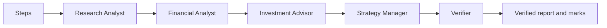

# Week 3 verified equity-research agent team

This CrewAI Flow rebuilds the Week 2 desk as a fixed graph in code.
The full graph always runs these nodes in this order:

1. Steps
2. Research Analyst
3. Financial Analyst
4. Investment Advisor
5. Strategy Manager
6. Verifier

The model never selects the next node.
The Verifier has no disable flag.
Every full run saves the node order, every node input and output, the report, the verifier input, the verifier output, and the verified report in the run folder.



## Install

From the repository root:

```bash
.venv/bin/python -m pip install -e equity_research_crewai
```

Keep the model key, base URL, model name, and SEC User-Agent in the repository `.env`.
Never commit `.env`.

## Run the full graph

```bash
.venv/bin/python -m equity_research_crewai.main TICKER \
  --peers AAA,BBB \
  --price 123.45 \
  --price-date YYYY-MM-DD \
  --price-source "LSEG Workspace"
```

To add the professor's optional FAskills methodology, add `--faskills`.
This option makes one Financial Datasets API request.
It saves local `faskills_financialdatasets.json` plus reviewable metrics, methodology, and DRIVER-trace files in the run folder.
The raw vendor response is ignored by Git.
The program cross-checks revenue, operating income, net income, diluted EPS, accession number, and period against the saved SEC run.
The remaining metric inputs are still vendor-derived, so every vendor-derived score is blocked from graded report use until all inputs are reproduced from SEC XBRL.

```bash
.venv/bin/python -m equity_research_crewai.main TICKER \
  --peers AAA,BBB \
  --price 123.45 \
  --price-date YYYY-MM-DD \
  --price-source "LSEG Workspace" \
  --faskills
```

The extension calculates Piotroski F-Score, both Altman model variants, Beneish M-Score, owner earnings, DuPont decomposition, Sloan accruals, gross profitability, and FCF conversion in a review-only sidecar.
It applies the nine FAskills frameworks as optional methodology labels without passing vendor metric values into the graded report.
The Research Analyst receives the Buffett, Lynch, Wood, and Soros lenses.
The Financial Analyst receives the Graham, Dalio, Burry, Simons, and Shiller lenses.
The Investment Advisor synthesizes only the two analyst outputs.
Each generated lens finding is labeled, and missing evidence produces `unavailable`.
The extension does not simulate current investor opinions, holdings intent, confidence votes, or automatic price targets.
It does not add or bypass a graph node.
The mandatory Verifier remains the final node.

Each FAskills run saves:

- `faskills_metrics.json`: deterministic metrics and SEC cross-check.
- `faskills_methodology.json`: all nine lens definitions, routing, data availability, and course boundaries.
- `faskills_driver_trace.json`: the visible DISCOVER, PROCESS, REPRESENT, IMPLEMENT, VALIDATE, EVOLVE, and REFLECT record.
- `faskills_methodology.md`: the human-readable methodology and lens-coverage report.

## Add supplementary Tavily web research

Add `--tavily` to make one focused web search before the Research Analyst runs.
The default `advanced` search uses 2 Tavily credits.
Use `--tavily-depth basic` to use 1 credit.

```bash
.venv/bin/python -m equity_research_crewai.main TICKER \
  --peers AAA,BBB \
  --price 123.45 \
  --price-date YYYY-MM-DD \
  --price-source "LSEG Workspace" \
  --faskills \
  --tavily
```

Set `TAVILY_API_KEY` in the repository `.env` for reliable repeated use.
If the key is absent, the program uses Tavily's official rate-limited keyless mode.
The program never prints or saves the key.

Each Tavily run saves:

- `tavily_research.json`: the exact query, request settings, result excerpts, URLs, dates, and course boundaries.
- `tavily_research.md`: a readable source record.

Tavily results are saved only as a research sidecar.
They are excluded from graded role hand-offs because a prior search returned stale and irrelevant pages.
They cannot replace SEC evidence for any audited claim.
The final `Insight:` line remains filing-bounded, and the Verifier remains the final graph node.

To correct or reproduce a saved run without spending another Tavily credit, use:

```bash
.venv/bin/python -m equity_research_crewai.main TICKER \
  --saved-run week03/runs/SAVED_RUN_WITH_TAVILY \
  --tavily \
  --reuse-tavily
```

`--reuse-tavily` requires `--saved-run` and an existing `tavily_research.json` file.

The original FAskills/Tavily graph run is:

`week03/runs/COSTCO_WHOLESALE_CORP_NEW_COST_20261109_020525`

Its report remains exactly what the graph produced. Its saved sidecars remain available for methodology review, and the Verifier visibly marks blocked web and vendor-derived numbers Unsupported. Historical `RECONCILED` folders are not desk output and are not submission proof.

To reuse an existing successful data folder while testing the graph:

```bash
.venv/bin/python -m equity_research_crewai.main TICKER \
  --saved-run week02/runs/SAVED_RUN_FOLDER
```

## Run only the Verifier

This command runs the Verifier and no other role:

```bash
.venv/bin/python -m equity_research_crewai.main \
  --verify-only week02/runs/SAVED_RUN_FOLDER
```

If the model endpoint is unavailable, the command still writes the deterministic marks to a new timestamped file and leaves the prior verified report unchanged.

## Start the page

```bash
.venv/bin/python -m streamlit run \
  equity_research_crewai/src/equity_research_crewai/ui.py
```

The page accepts a ticker, peers, price, price date, and price source.
It streams each node name and displays the verified report when the run ends.

## Plot the graph

```bash
cd equity_research_crewai
../.venv/bin/python -c 'from equity_research_crewai.main import plot; plot()'
```

## Lab 05 personas

Devashish Batra supplied the design, purpose, criteria, source boundaries, change conditions, and output rules for all three personas.
The exact student draft is preserved in `week03/persona_original_draft.md`.
Written confirmation of any permitted AI wording edits remains a human follow-up if the instructor requests it.
The final six-part persona files are in `src/equity_research_crewai/roles/`.
Operational citation and graph rules are kept separately in `src/equity_research_crewai/roles/operating_rules.md`.
Each role must end with one `Insight:` line.
Every number in that line must carry its own exact filing-line or code-calculation citation.

This is a learning exercise, not financial advice.

AI assistance: OpenAI Codex helped build and test the fixed graph and verifier. I verified the sources myself; the judgments are mine.

Any remaining errors are my own.
