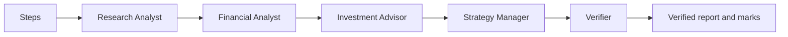

# Week 3 verified equity-research agent team

This CrewAI Flow rebuilds the Week 2 desk as a fixed graph in code.
The full graph always runs these nodes in this order:

1. Steps
2. Research Analyst
3. Financial Analyst
4. Investment Advisor
5. Strategy Manager
6. Verifier

The model never selects the next node.
The Verifier has no disable flag.
Every full run saves the node order, every node input and output, the report, the verifier input, the verifier output, and the verified report in the run folder.



## Install

From the repository root:

```bash
.venv/bin/python -m pip install -e equity_research_crewai
```

Keep the model key, base URL, model name, and SEC User-Agent in the repository `.env`.
Never commit `.env`.

## Run the full graph

```bash
.venv/bin/python -m equity_research_crewai.main TICKER \
  --peers AAA,BBB \
  --price 123.45 \
  --price-date YYYY-MM-DD \
  --price-source "LSEG Workspace"
```

To reuse an existing successful data folder while testing the graph:

```bash
.venv/bin/python -m equity_research_crewai.main TICKER \
  --saved-run week02/runs/SAVED_RUN_FOLDER
```

## Run only the Verifier

This command runs the Verifier and no other role:

```bash
.venv/bin/python -m equity_research_crewai.main \
  --verify-only week02/runs/SAVED_RUN_FOLDER
```

## Start the page

```bash
.venv/bin/python -m streamlit run \
  equity_research_crewai/src/equity_research_crewai/ui.py
```

The page accepts a ticker, peers, price, price date, and price source.
It streams each node name and displays the verified report when the run ends.

## Plot the graph

```bash
cd equity_research_crewai
../.venv/bin/python -c 'from equity_research_crewai.main import plot; plot()'
```

## Lab 05 personas

Devashish Batra supplied the design, purpose, criteria, source boundaries, change conditions, and output rules for all three personas.
The professor permitted AI-assisted editing after the student supplied that design.
The final six-part persona files are in `src/equity_research_crewai/roles/`.
Each role must end with one `Insight:` line.
Every number in that line must carry its own exact filing-line or code-calculation citation.

This is a learning exercise, not financial advice.

AI assistance: OpenAI Codex helped build and test the fixed graph and verifier. I verified the sources myself; the judgments are mine.

Any remaining errors are my own.
